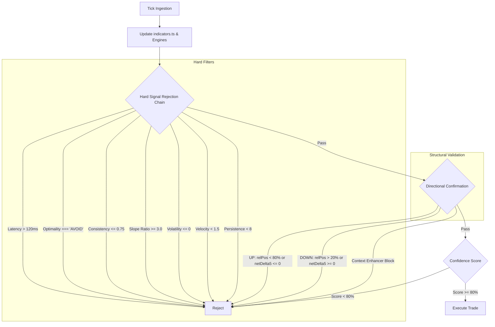

# Decision Pipeline Optimization & Audit Report

This report presents a thorough audit of the `RevangeWise5s` trading decision pipeline, from tick ingestion to trade execution. It identifies scoring inflation, logic redundancies, and specifies a streamlined, high-performance production architecture.

---

## 1. Phase 1 — Decision Pipeline Audit

The following table catalogs every variable displayed on the live CLI dashboard:

| Dashboard Variable | Where Computed | Affects Decisions? | Mode / Type | Recommendation / Action |
| :--- | :--- | :--- | :--- | :--- |
| **Session Quality** | `indicators.ts` (L1680) | No | Informational | Upgrade to hard gatekeeper: Reject if `AVOID` (optimality score < 45). |
| **Trend Persistence** | `indicators.ts` (L1531) | Yes | Hard Filter & Soft Score | Keep as hard gatekeeper; remove from soft scoring. |
| **Trend Age** | `trendAgeEngine.ts` | Yes | Hard Filter (via Context) | Keep as hard block via Context (`IMMATURE_TREND` if < 10s). |
| **ZLEMA Consistency** | `indicators.ts` (L1590) | Yes | Hard Filter & Soft Score | Keep as hard gatekeeper (`consistency > 0.75`); remove from soft scoring. |
| **Volatility (avgDiff)** | `indicators.ts` (L1510) | Yes | Hard Filter & Slope Ratio | Keep as scale-invariant divisor & division guard (`volatility <= 0`). |
| **Velocity** | `indicators.ts` (L1523) | Yes | Hard Filter & Soft Score | Keep as hard gatekeeper (`velocity >= 1.5`); remove from soft scoring. |
| **NetDelta5** | `indicators.ts` (L1629) | Yes | Hard Filter | Keep as direction-specific confirmation filter. |
| **Relative Position** | `indicators.ts` (L1571) | Yes | Hard Filter & Soft Score | Keep as breakout validation; remove from soft scoring. |
| **S/R Distance** | `srMemoryEngine.ts` | Yes | Hard Filter (via Context) | Keep as hard block via Context (block entry near major zones). |
| **Strongest Zone** | `srMemoryEngine.ts` | No | Informational | Keep as informational. |
| **Touch Count** | `levelEngine.ts` | Yes | Hard Filter (via Context) | Used to classify S/R strength inside Context blocks. |
| **Market Range** | `candleEngine.ts` | No | Informational | Keep as informational. |
| **Candles Stored** | `candleEngine.ts` | No | Informational | Keep as informational. |
| **WebSocket Latency** | `cli.ts` (L136) | No | Informational | Upgrade to hard filter: Reject entry if ping latency > 120ms. |
| **Regime Filter (HMM)** | `regimeDetector.ts` | Yes | Hard Filter (if enabled) | Keep deactivated in production (proved prone to OOS drift). |
| **Block Reasons** | `contextEnhancer.ts` | Yes | Hard Filter | Keep as primary block filter (`respectBlocks = true`). |

---

## 2. Phase 2 — Redundant Logic Detection

Our audit revealed significant logic duplication and redundant code paths:

1. **Trend Persistence Check Double-Gate**:
   * *The Redundancy*: `indicators.ts` blocks any trade with `persistence < 8`. However, `contextEnhancer.ts` independently enforces `WEAK_PERSISTENCE` block if `persistence < 4`.
   * *Impact*: The enhancer block is unreachable because the main indicator pipeline already filtered it.
   * *Remedy*: Remove the `WEAK_PERSISTENCE` check from `contextEnhancer.ts`.
2. **HTF Bias & Velocity Score Duplication**:
   * *The Redundancy*: HTF alignment and velocity are checked as hard filters. Yet, they also add $+15$ points each to the confidence score.
   * *Impact*: Since a trade cannot execute unless these filters pass, these points are permanently awarded to all executed trades.

---

## 3. Phase 3 — Missing Gatekeepers

To protect execution quality, we identify two missing gatekeeper rules:

1. **Latency Guard**:
   * *Rule*: Reject execution if `wsLatency > 120ms`.
   * *Justification*: Stale prices lead to entering breakouts after the move has run, incurring slippage.
   * *Drawbacks*: May miss valid trades during brief network hiccups, but preserves capital.
2. **Session Quality Guard**:
   * *Rule*: Reject trades if `optimalityStatus === 'AVOID'`.
   * *Justification*: Prevents trading when both trendiness and consistency are depleted.
   * *Drawbacks*: Restricts trading frequency, but filters out choppy market conditions.

---

## 4. Phase 4 — Confidence Score Audit

The original confidence score calculation is heavily inflated. 

### Points Breakdown for Executed Trades:
* Trend presence: $+15$
* Persistence ($\ge 8$): $+15$
* HTF Bias (Aligned): $+15$
* Breakout Zone (relPos): $+20$
* Consistency ($> 0.75$): $+15$
* Micro-Velocity ($\ge 1.5$): $+15$
* **Total Base Score**: **$95$**

Every trade that satisfies the entry filters starts with a base score of $95$. Because the entry threshold is $80$, the confidence score filter **never rejects a trade**. The score is structurally inflated and provides no differentiation.

### Recommendation:
Remove binary gatekeepers from scoring. Change confidence score to be derived strictly from:
$$\text{Score} = \text{Consistency} \times 50 + \text{AssetTrendiness} \times 100$$
This ensures the confidence score represents true trend strength and consistency, rather than a checklist of baseline gates.

---

## 5. Phase 5 — Execution Quality

We recommend the following execution safeguards inside `cli.ts`:
1. **Indicator Convergence Check**:
   * Guard: Reject trade if `trendAge < 10 seconds` (prevents entering immediately on ZLEMA crossover noise).
2. **Cooldown Enforcement**:
   * Guard: Keep a strict 5-second cooldown after a trade exits to prevent double-entries on the same breakout.

---

## 6. Phase 6 — Final Production Architecture

This streamlined decision pipeline focuses exclusively on high-quality setups by removing score inflation and logic redundancies.
